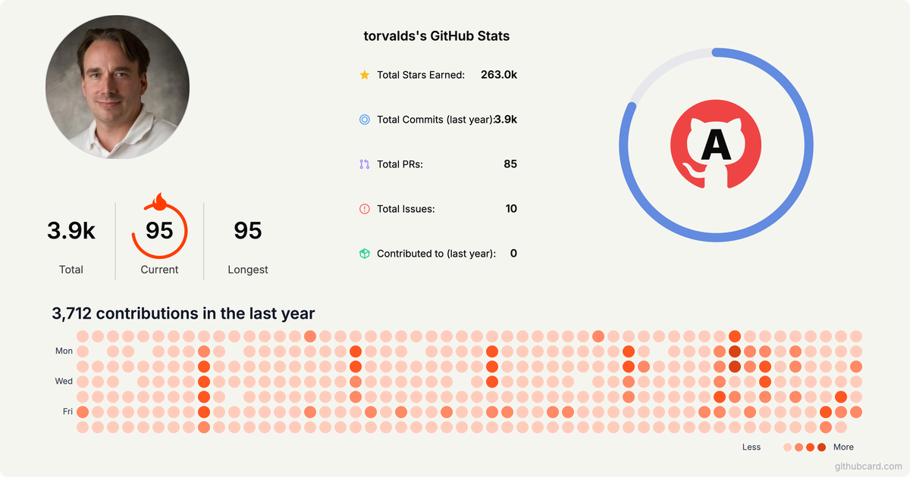
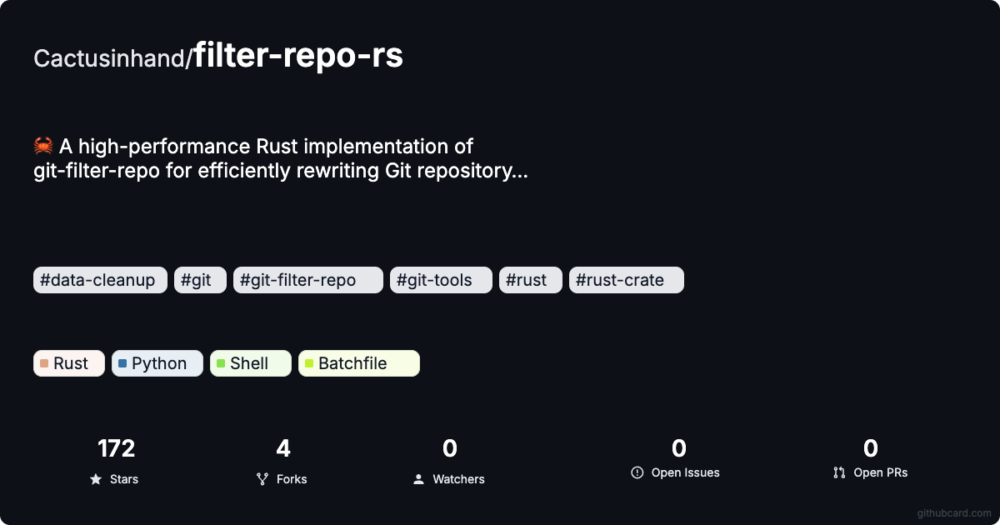

<p align="center">
  <a href="https://githubcard.com">
    <picture>
      <source media="(prefers-color-scheme: dark)" srcset="https://githubcard.com/brand/githubcard-lockup-white.svg">
      
    </picture>
  </a>
</p>

### GitHub profile and repository cards, made for READMEs

[GitHubCard](https://githubcard.com) turns any GitHub user or repository into a card image with live data: stars, languages, contributions, contributors. Embed it in a profile README, use it as a social preview, or share it as a link.

<a href="https://githubcard.com/~profile-card"></a>
<a href="https://githubcard.com/~repo-card"></a>

**Make one in the browser:** [githubcard.com](https://githubcard.com), with templates and a drag-and-drop editor.

**Or from your terminal, CI, or AI agent:**

```bash
npx -y @ghcardhq/ghcard create <your-username> --readme README.md
```

| Repository | What it is |
| --- | --- |
| [ghcard](https://github.com/ghcardhq/ghcard) | CLI for scripts and CI, with a local MCP server |
| [githubcard-mcp](https://github.com/ghcardhq/githubcard-mcp) | Hosted MCP server at `https://githubcard.com/mcp` for Claude, Cursor, VS Code and others |
| [skills](https://github.com/ghcardhq/skills) | Claude Code plugin and agent skill |
| [GithubCard](https://github.com/ghcardhq/GithubCard) | Showcase of profile and repository cards |

[Website](https://githubcard.com) · [Profile cards](https://githubcard.com/~profile-card) · [Repo cards](https://githubcard.com/~repo-card) · [README examples](https://githubcard.com/~readme-examples) · [Pricing](https://githubcard.com/~pricing) · [Feedback](https://githubcard.featurebase.app/)
